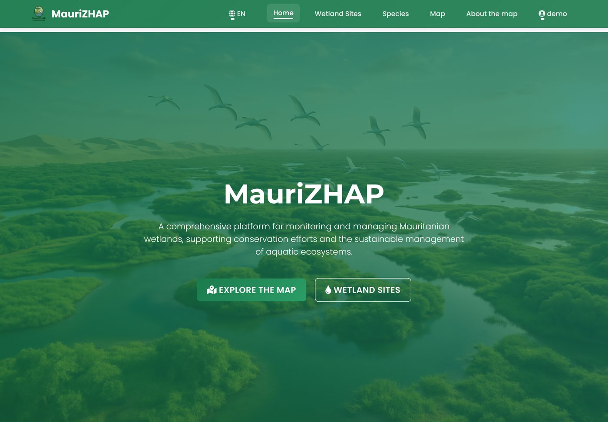
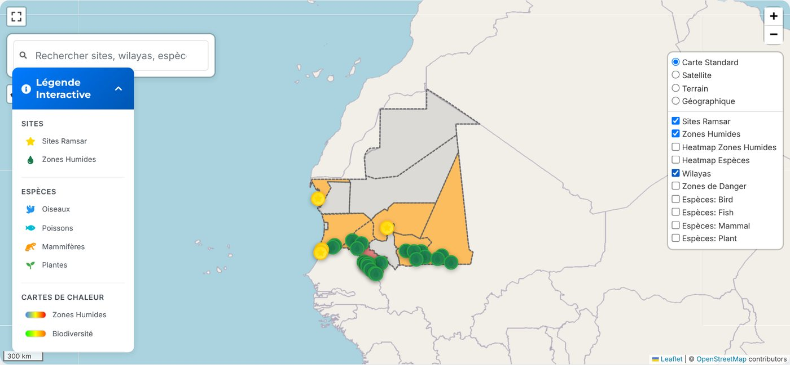
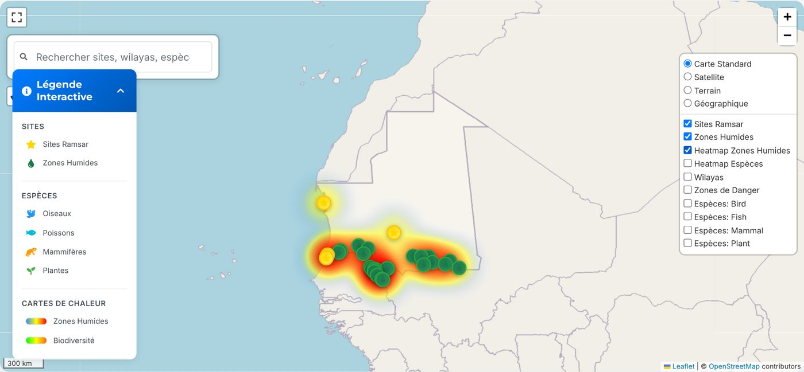
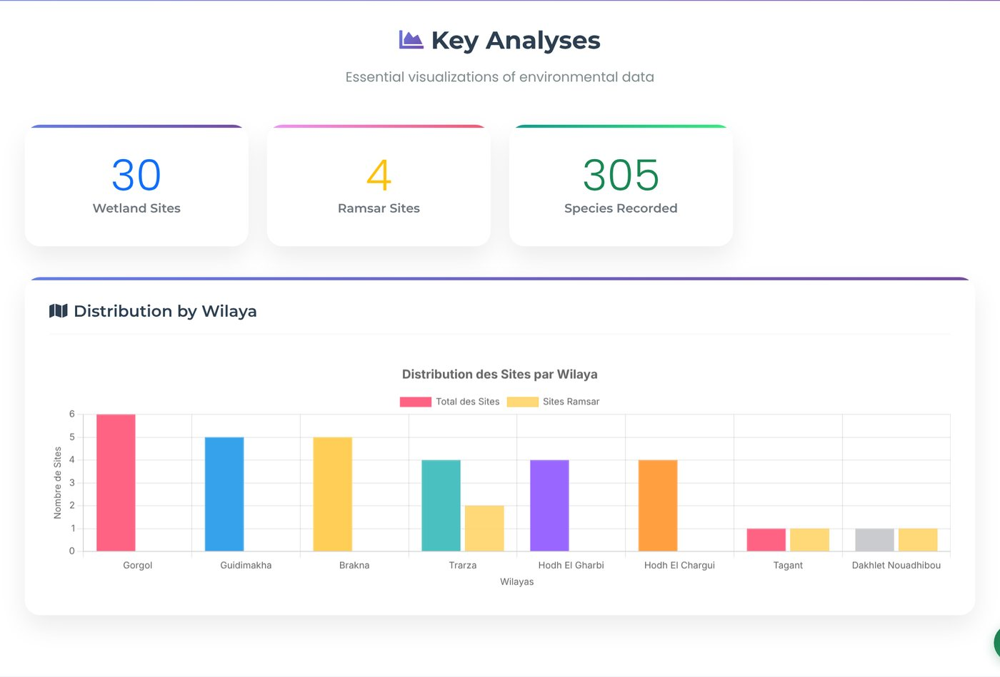
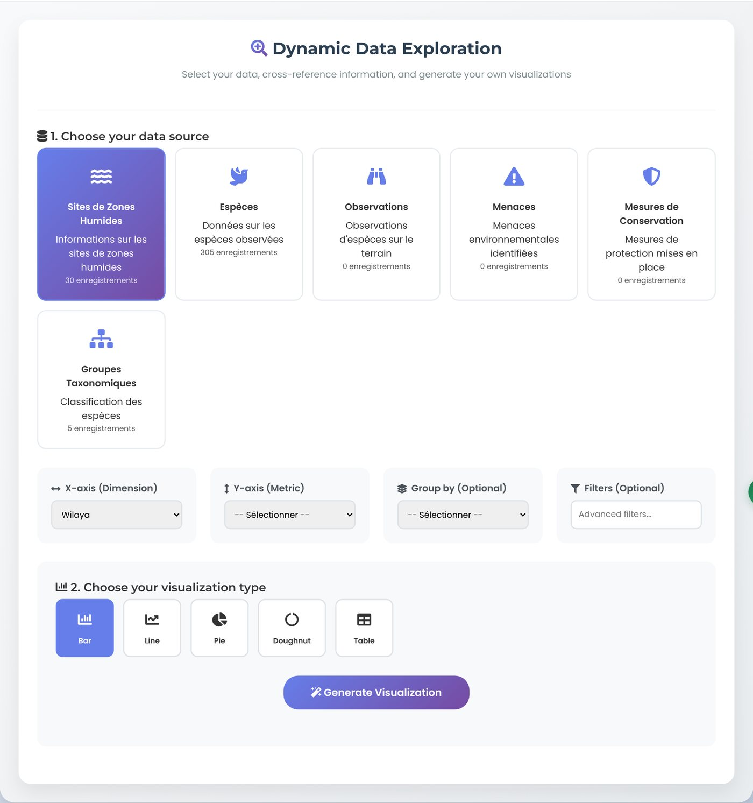
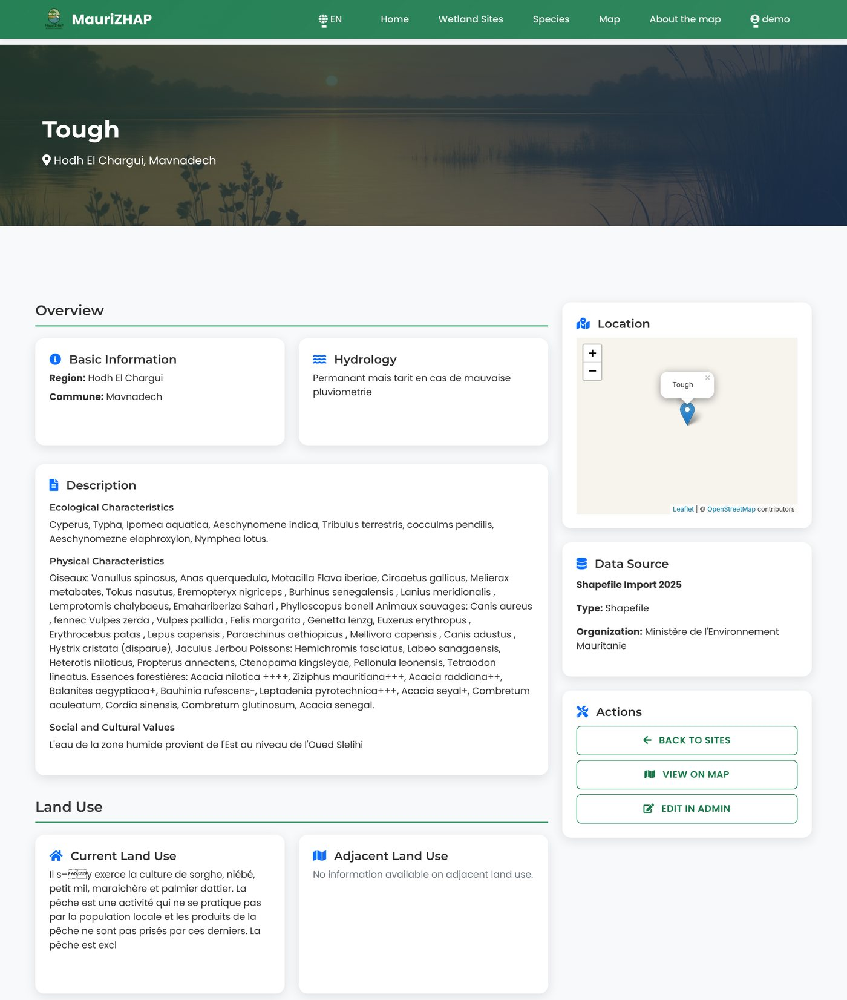
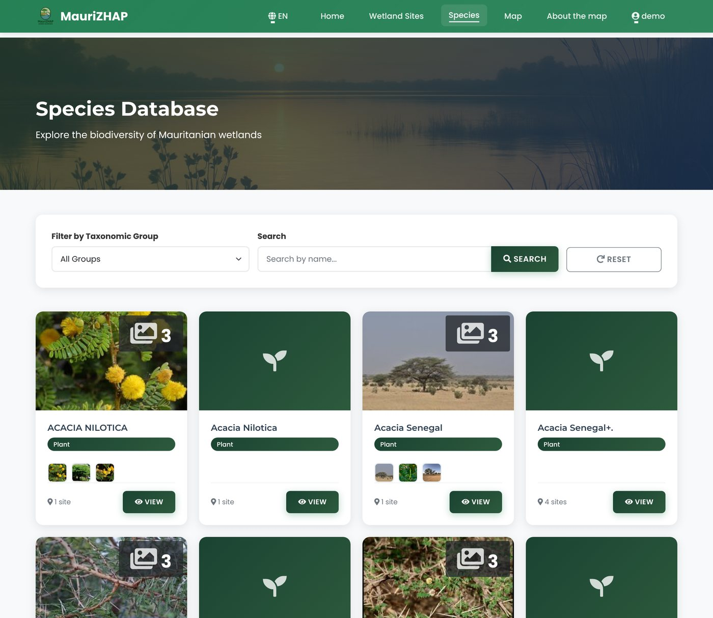
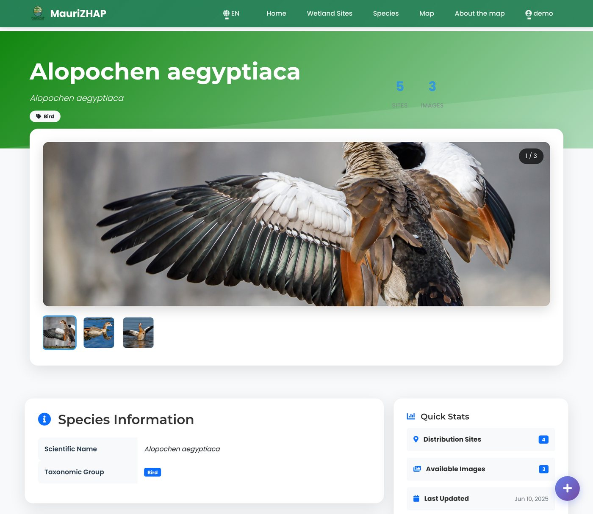
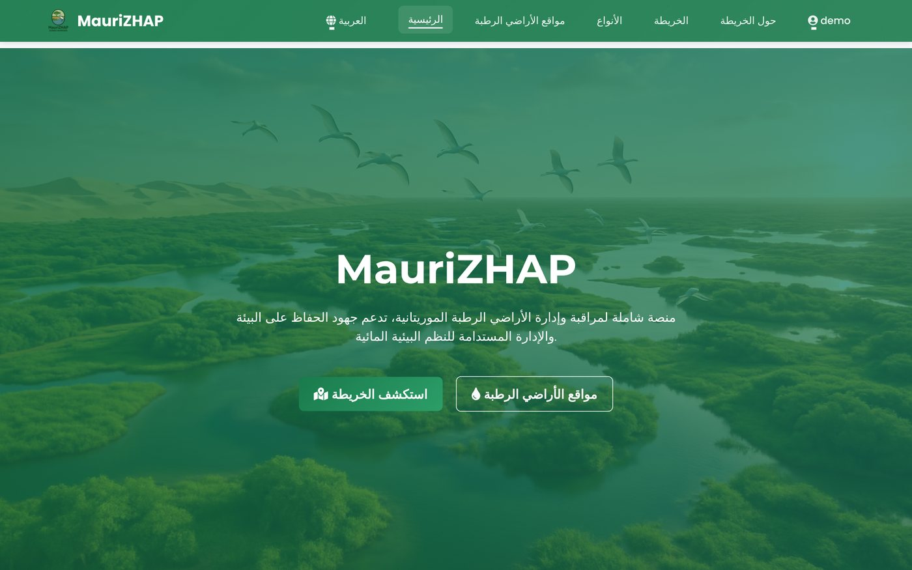

# MauriZHAP — Mauritania's wetlands in one spatial database and web map

**A GeoDjango platform that brings together Mauritania's wetland sites, the species recorded at each one, and their threats and conservation measures, and puts them on an interactive map in English, French and Arabic.**

Live: [mrwetlands.pythonanywhere.com](https://mrwetlands.pythonanywhere.com/en/) · 2025



---

## The problem

Information on Mauritania's wetlands was scattered across shapefiles from the Ministry of Environment, the Ramsar Convention's site records and spreadsheets of species inventories. None of these linked a site to the species found there, and none of them was something a field officer or a decision-maker could browse.

**MauriZHAP joins these sources into a single spatial database** and builds the views people actually need on top of it: where the wetlands are, what lives in each one, and what threatens them.

## What's in the database

| | Count |
|---|---|
| **Wetland sites** | **30**, each with a point location, including the country's **4 Ramsar sites** (Banc d'Arguin, Diawling, Chat Tboul, Lac Gabou) |
| **Species** | **305**: 138 plants, 63 mammals, 60 fish, 43 birds |
| **Site–species records** | **911**, covering 23 sites |
| **Threats and conservation measures** | catalogues of 81 threats and 91 measures |
| **Administrative boundaries** | 13 wilayas (GeoJSON) |
| **Species photos** | 368 images for 132 species |

Sources: wetland shapefiles from the Ministère de l'Environnement (Mauritania), the Ramsar Convention's site records, and species inventories (cleaned CSVs in [`data/source_csv/`](data/source_csv)).

## The map

All sites on one map, with Ramsar sites marked by a star. Layers add the wilaya boundaries, a heatmap of site density, species layers by group, and three alternative basemaps. You can filter by wilaya or site type and search by name.



The density heatmap makes the pattern obvious: almost every wetland lies along the Senegal River valley and in the south-east, and the north of the country is nearly empty.



## Analysis and data exploration

A dashboard summarises the database: counts of sites and species, and the number of sites per wilaya, split into Ramsar and other wetlands.



A query builder lets non-technical users choose a dataset (sites, species, taxonomic groups…), a dimension, a metric and a chart type, then export the result as PNG or CSV.

<details>
<summary>Query builder screenshot</summary>


</details>

## Sites and species

Every site has a page with its location, hydrology, ecological description, land use, species inventory, threats and conservation measures.



The species catalogue can be filtered by taxonomic group. Each species page shows photos, the sites where it was recorded and its distribution on a map.

| Species catalogue | Species page |
|---|---|
|  |  |

## Three languages

The interface is available in English, French and Arabic, with a right-to-left layout for Arabic. Some data labels stay in French, the language of the source records.



## How it's built

| Layer | Tools |
|---|---|
| Spatial database | SQLite + SpatiaLite through **GeoDjango** (point geometries for sites, polygons for wilayas) |
| Data loading | Django management commands that import the shapefiles, Ramsar sites, species, site–species inventory, photos and wilaya GeoJSON |
| Backend and API | Django 5: pages, JSON endpoints for the map layers, dashboard and query builder |
| Map | **Leaflet** with heatmap and fullscreen plugins |
| Charts | Chart.js |
| Interface | Bootstrap 5; Django i18n for English / French / Arabic |

```
├── core/                       the application: models, views, API, templates, static files
│   └── management/commands/    data import scripts (import_wetland_sites, import_species, …)
├── geoWetlands_mauritania/     project settings and URLs
├── data/
│   ├── source_csv/             cleaned source tables (sites, species, threats, measures, inventories)
│   ├── wilayas.geojson         administrative boundaries
│   └── species_fixture.json
├── locale/                     French and Arabic translations
├── media/species_images/       species photos
├── docs/screenshots/
└── db.sqlite3                  the populated spatial database (no user accounts)
```

## Run it locally

GeoDjango needs the GDAL, GEOS, PROJ and SpatiaLite system libraries. On Ubuntu: `sudo apt install gdal-bin libsqlite3-mod-spatialite`. On macOS: `brew install gdal spatialite-tools`.

```bash
python -m venv venv && source venv/bin/activate
pip install -r requirements.txt
export DJANGO_DEBUG=1                  # local development only
python manage.py migrate
python manage.py createsuperuser       # pages require a login
python manage.py runserver
```

Then open http://127.0.0.1:8000/en/.

**In production**, set `DJANGO_SECRET_KEY`, `DJANGO_DEBUG=0` and `DJANGO_ALLOWED_HOSTS` as environment variables (see [`.env.example`](.env.example)). Secrets are never stored in the code.

## Data notes

- Site records come from the Ministry shapefiles and keep their original French text. A few fields are truncated in the source.
- Field observations (dated sightings) are modelled but not yet loaded, so the "biodiversity over time" view is empty for now.
- The species photos are for illustration, and their original sources are not recorded in this repository.
- The screenshots were taken from a local copy of the app, with a simplified offline basemap.

## Author

**Mohamedou Loughmane**, data analyst · [LinkedIn](https://www.linkedin.com/in/mohamedou-loughmane-38b898282/) · loughmanemohamedou@gmail.com
